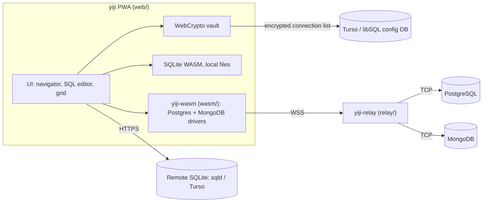

# Yiji design

Yiji is a database client that runs in the browser as a PWA. The browser and the database do the work. The only server piece is a small Rust relay that turns a WebSocket into a TCP connection, because browsers cannot open TCP sockets.

## Goals

- v1 databases: PostgreSQL, MongoDB, SQLite.
- Layout familiar to DBeaver users: menu bar, toolbar, Database Navigator tree on the left, editor tabs on the right, results grid under the SQL editor, status bar. Plain and dense. No dashboard-style or card-based UI.
- Works on desktop and phone browsers, installable as a PWA.
- Relay stays cheap enough for a single-board computer (target: Orange Pi Zero 3). It never parses queries or rows.

## Non-goals for v1

ER diagrams, data transfer wizards, schema compare, SSH tunnels, query plans, MySQL, SQL Server, Oracle.

## Architecture



| Part | Path | Language | Does |
|------|------|----------|------|
| PWA | `web/` | TypeScript, Preact, Vite | UI, connection store, SQLite |
| Drivers | `wasm/` | Rust to WASM | Postgres and MongoDB wire protocols over a byte stream |
| Relay | `relay/` | Rust, tokio | WebSocket to TCP, auth, host allowlist |

## Relay protocol (v1)

1. Client opens a WebSocket to the relay URL (for example `wss://relay.example/`).
2. Client sends one text frame, JSON: `{"token":"<relay token>","host":"db.lan","port":5432}`.
3. Relay checks the token (constant-time compare) and that `host:port` is in its allowlist.
   - On success it opens TCP to `host:port` and sends one text frame: `ok`.
   - On failure it closes with code 1008 and a short reason (`bad token`, `target not allowed`, `connect failed`).
4. After `ok`, every frame in both directions is binary and carries raw database protocol bytes. The relay copies bytes and nothing else. Text frames after `ok` close the connection.
5. Either side closing ends both the WebSocket and the TCP connection.

Relay config, all from environment variables:

| Variable | Example | Meaning |
|----------|---------|---------|
| `YIJI_LISTEN` | `127.0.0.1:8080` | Address to listen on. TLS is terminated in front (Cloudflare Tunnel, Tailscale, reverse proxy). |
| `YIJI_TOKEN` | 32+ random chars | Shared secret. Relay refuses to start without it. |
| `YIJI_ALLOW` | `db.lan:5432,10.0.0.5:27017` | Comma-separated `host:port` targets. Exact match. Refuses to start if empty. |
| `YIJI_ORIGINS` | `https://sudtanj.github.io` | Optional comma-separated allowed `Origin` values. |

The token goes in the first frame because browsers cannot set custom headers on a WebSocket, and query strings end up in logs.

## Driver API (`yiji-wasm`)

Built with `wasm-pack build --target web`. Results cross into JS as JSON strings so the UI owns rendering.

```ts
// relay: { url, token }, target: { host, port }
class PgConn {
  static connect(relayUrl: string, relayToken: string, host: string, port: number,
                 user: string, password: string, database: string): Promise<PgConn>;
  // Returns JSON: {"columns":[{"name":"id","type":"int4"}],"rows":[[1]],"rowsAffected":null}
  // Multiple statements: result of the last one that returned rows, else rowsAffected of the last.
  query(sql: string): Promise<string>;
  close(): void;
}
class MongoConn {
  static connect(relayUrl: string, relayToken: string, host: string, port: number,
                 user: string, password: string, authDb: string): Promise<MongoConn>;
  // cmdJson is a MongoDB command document in relaxed Extended JSON, e.g. {"find":"users","limit":200}
  // Returns the reply document as relaxed Extended JSON.
  runCommand(db: string, cmdJson: string): Promise<string>;
  close(): void;
}
```

Errors reject the promise with a message string. The protocol code is generic over `AsyncRead + AsyncWrite` so the same code runs in native tests against real databases.

- PostgreSQL: `tokio-postgres` `connect_raw` over the WebSocket stream.
- MongoDB: OP_MSG framing, `bson` crate, SCRAM-SHA-256 auth, written in this repo.

## Connection store

- Connections are saved in a Turso (libSQL) database the user owns, through `@libsql/client/web`. If no Turso database is configured, they are saved in the browser's `localStorage`.
- Every saved connection (including relay token and DB password) is encrypted in the browser with AES-GCM. The key comes from a master password through PBKDF2-SHA-256. The master password is never stored or sent anywhere.

## SQLite

- Local file: opened with the official SQLite WASM build, held in memory, saved back by download.
- Remote: libSQL `sqld` or Turso over HTTPS with `@libsql/client/web`. No relay.

## Security notes

- The relay is an entry point into the network it runs in. Run it only behind TLS, with a long random token and the smallest allowlist that works.
- v1 does not run TLS from the browser to the database. The relay host sees database traffic in plain form. End-to-end TLS (rustls in WASM) is planned.
